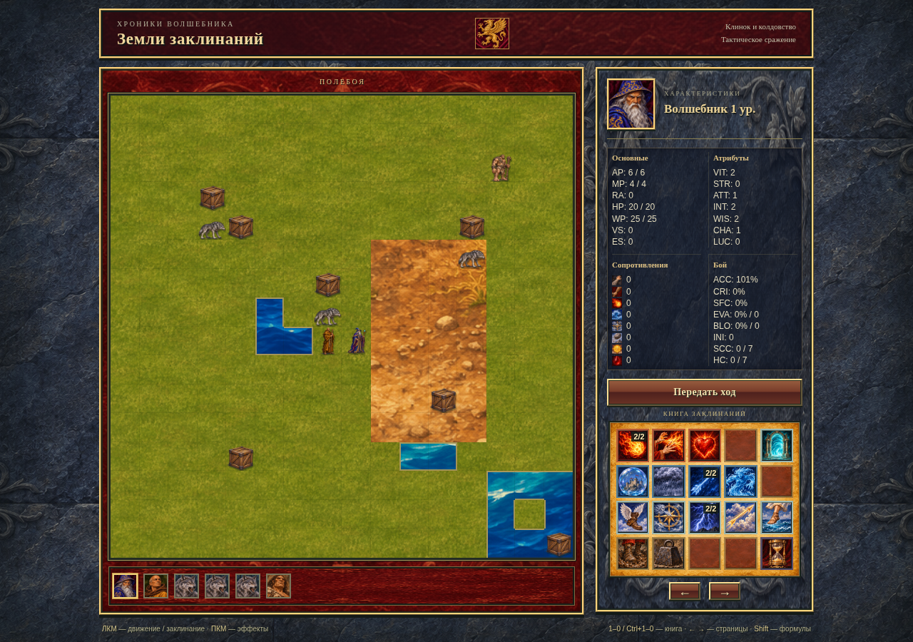

# Графическое оформление в духе HoMM II

Ветка `dev-homm2-graphics`: живописная растровая графика в духе фэнтези-стратегий
1990-х. Детализированные существа с реалистичными пропорциями, отдельные портреты,
иллюстрированные иконки заклинаний и состояний, поле 12×12 с тайлами
48×48 и автотайлингом из MapEditor. В панели и очереди отображаются портреты существ.
Общий фон тёмно-серый; поле, очередь и панель существа не имеют декоративной
подложки. Правая панель примыкает к полю без отступа, блок характеристик имеет бежевый
фон и тёмно-коричневый текст. Панель занимает доступную высоту и не обрезает содержимое:
при низком окне прокручивается вся страница, а не панель. Книга — сетка иконок вплотную, без фона,
внутренних отступов, заголовка и пояснений по управлению. Иконки заклинаний —
64×64 в одобренном стиле DOS/VGA: насыщенные цвета, чёрные тени, резкие блики,
пиксельная прорисовка и свободное место на тёмном тематическом градиенте.
Общий лист содержит 33 иконки и три пустые ячейки. Девять согласованных правок
включены в этот лист: тонкий огненный выстрел, щит без внешнего пламени,
ледяное оперение стрелы, замороженный мечник, четыре вихря, радиальная искра,
серебристый каркас часов, дубина без шипов и зубы с дёснами.
Крылатый сапог и сапог с ярко-серебряной цепью обозначают состояния «Скорость»
и «Медлительность». У заклинания «Ускорение» — облако с лицом, дующее вправо,
у «Замедления» — крупный план пояса и ног по колено в грязи, с обрезкой по верхнему краю.
Облако дождя белое, огненный щит
соразмерен остальным защитам, каркас песочных часов ярко-серебряный.
Все 17 состояний и часы времени жизни используют тот же пиксельный стиль.
У «Адреналинового отката» нет жёлтых капель, у «Охлаждения» — только снежинка,
у «Слабости» — бледная рука без вихрей. «Истощение» изображает руку,
пытающуюся создать едва светящуюся сферу.
Тултипы имеют однотонный тёмный
фон; счётчики применений и цифры превью отображаются без подложек.
Все ресурсы локальные: внешние шрифты, CDN и загрузка чужих игровых ресурсов не нужны.

[Мобильный вариант, 390×844](docs/homm2-mobile.png)

[Набор иконок заклинаний в исходном размере 64×64](docs/spell-icons-64.png)

[Набор иконок состояний и времени жизни, 64×64](docs/state-icons-64.png)

[Девять исправленных иконок крупно, без сглаживания](docs/spell-icons-fixed-details.png)

[Первый вариант для сравнения](https://github.com/LandsOfKanneghem/Battle/blob/bea144d/docs/homm2-desktop.png)

## Как устроено

- `homm2.css` — оформление и адаптивная вёрстка.
- `homm2-graphics.js` — замена иллюстраций в SVG и портрет существа, показанного
  в панели. Ссылки на объекты способностей сохраняются.
- `terrain-renderer.js` и `assets/map-editor/terrain/` — те же атласы, 47 масок
  границ и порядок слоёв, что в MapEditor: трава → грязь → болото → песок → вода.
- `assets/map-editor/mobs/` — исходники 60×72 из редактора. На поле волк и
  великан отображаются в 90×108, маг, монах и дух озера — в 72×86, с привязкой к низу
  и центру клетки. На краях поля спрайты обрезаются без смещения.
- `init.js` использует `maps/MAP 1.js` — JS-копию `maps/MAP 1.json` для запуска
  без сервера. Кнопка папки слева вверху позволяет начать новый бой на другой
  JSON-карте. Формат и обновление стартовой карты описаны в `maps/README.md`.
- `assets/homm2/` — используемые игрой компактные PNG.
  Портреты подготовлены в 144×144, иконки в 64×64. Старые полевые спрайты
  и фоны травы/песка/воды удалены: вместо них используются ресурсы MapEditor.
- `assets/homm2/sources/` — исходные сгенерированные иллюстрации:
  портреты, материал кожи и иконки. Неиспользуемые лист существ и трава удалены. `spell-icons-base.png` хранит исходный одобренный лист,
  `spell-icons-edits.png` — исходные девять правок. Их реальные границы определяются
  по чёрным разделителям: высота рядов в сгенерированном изображении неодинакова.
  Каждая правка целиком вписывается в 64×64 с сохранением пропорций.
  `spell-state-updates.png` содержит пять обновлений заклинаний и четыре состояния,
  `state-icons.png` — ещё девять состояний/часов. Их границы также определяются
  по реальным разделителям, а не предполагаемым равным долям листа.
  Крылатый сапог для «Скорости» берётся из исходного листа;
  `state-slowness-silver.png` сохраняет одобренный сапог с цепью для «Медлительности».
  «Заморозка», «Тяжесть» и «Старость» используют соответствующие пиксельные
  иллюстрации заклинаний. Неоднозначная разметка останавливает сборку.
  Только сопротивления сохраняют иллюстрации из `icons.png`.
  `sources/refinements/` хранит пять отдельных уточнённых иконок в 64×64
  с общей палитрой; они заменяют только соответствующие ячейки при сборке.
  Исходники не загружаются самой игрой.
- `docs/spell-icons-64.png` — единственная копия собранного листа заклинаний:
  индексированный PNG 384×384 с общей 256-цветной палитрой. Сборщик обновляет
  его вместе с отдельными иконками. Неиспользуемые фоны и герб не создаются.
- `docs/state-icons-64.png` — собранный лист 18 иконок состояний и времени жизни
  с той же палитрой; сборщик обновляет его вместе с отдельными PNG.
- `tools/build-homm2-assets.py` — воспроизводимая нарезка и подготовка PNG,
  Python + Pillow. Масштабирование портретов и палитра до 256 цветов
  не меняют игровые данные. Старый `build-pixel-art.py` вызывает эту же сборку.
  Запуск: `python tools/build-homm2-assets.py`. Для самой игры Python не нужен.
- `index.html` — подключение оформления и портрет существа; лишние декоративные подписи удалены.

Боевые модули, характеристики, карта, прицеливание, поиск пути, ИИ, очередь,
таймеры и обработчики клавиш/кликов не изменены. Сохранены доступные имена,
тултипы, состояния кнопок и бейджи. На телефоне доступна вертикальная прокрутка,
чтобы поле и книга оставались читаемыми.

## Проверка

В Chromium сравнивалось состояние боя с `dev` после одинаковых действий:
движение, подготовка клавишей, Shift, каст и превью, защита, переключение страниц,
призыв, движение и выстрел духа, просмотр эффектов, передача хода и действия ИИ.
Результаты совпали на компьютере и мобильном экране. Отдельно проверены
загрузка всех PNG, переполнение очереди, фокусные тултипы и ширины 320–1440 px.

Исходная игра сохранена в `dev`: переключение на эту ветку возвращает прежний вид.
Графическая ветка не изменяет и не перезаписывает `dev`.
